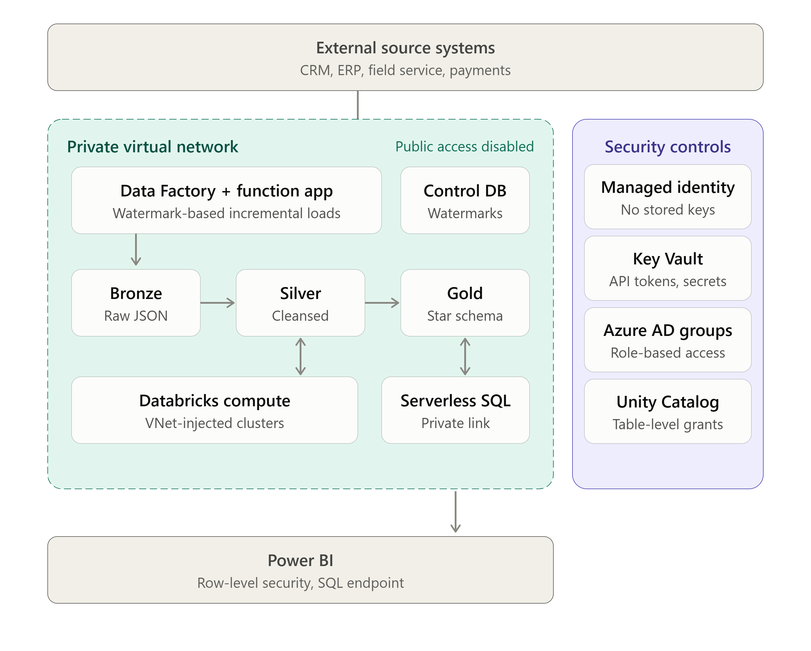
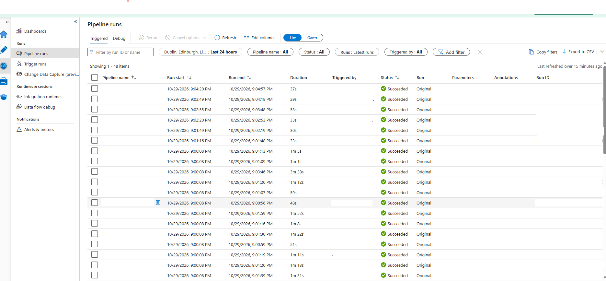
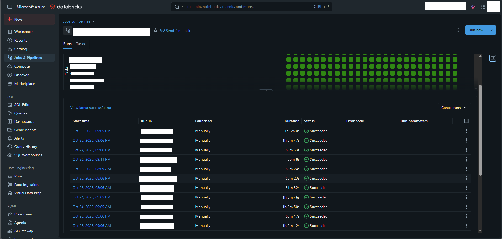
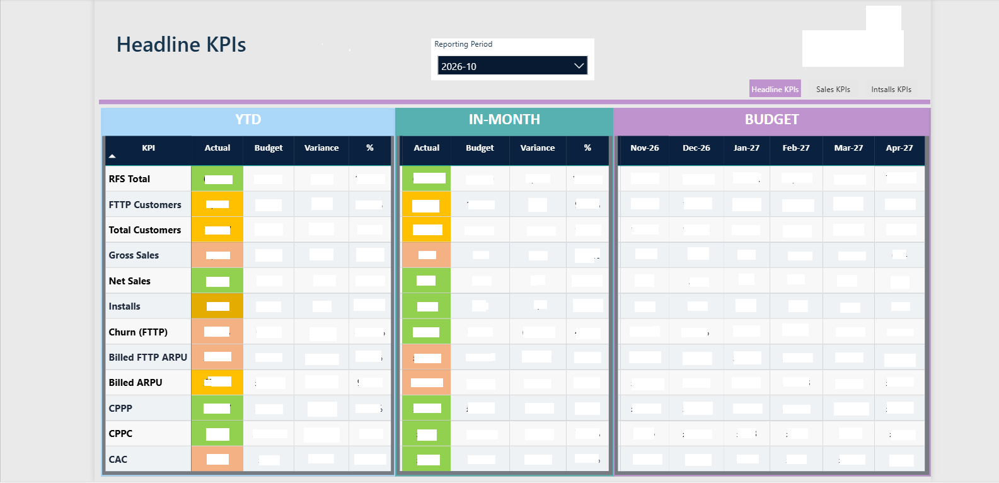
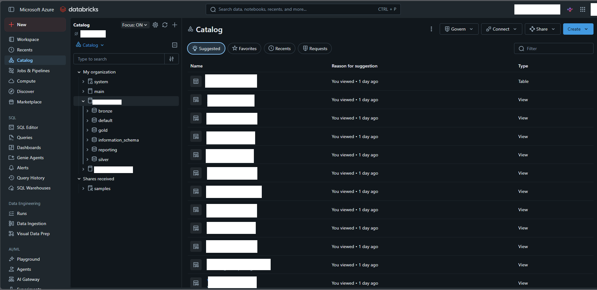
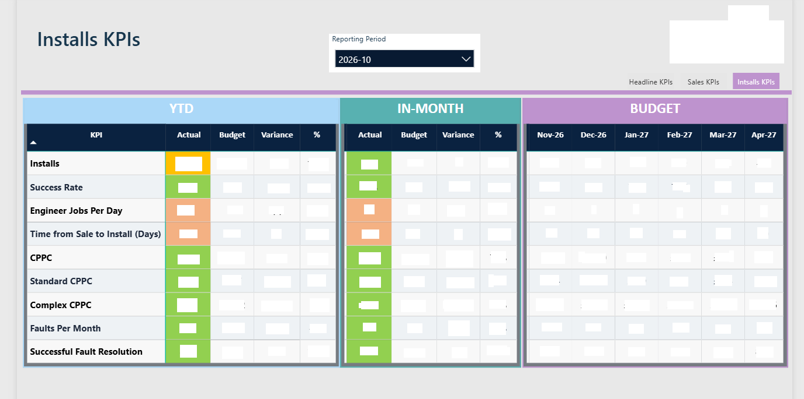
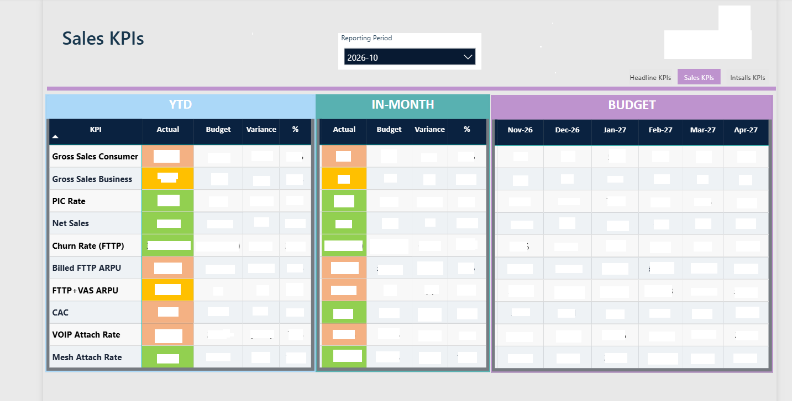
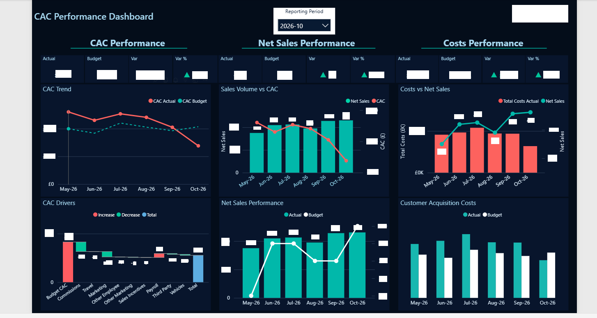

# Azure Medallion Data Platform
### End-to-End Data Engineering Portfolio Project

> **Production data platform** built for a UK ISP — ingesting data from 7 source systems into a governed, layered analytics environment serving business KPIs to Power BI.

---

## Tech Stack

---

## Architecture Overview

---

## Key Engineering Decisions

### 1. Watermark-Based Incremental Ingestion
All ADF pipelines use a two-watermark pattern — capturing the new watermark **before** the copy activity ensures no data is lost if the pipeline fails mid-run. CRM appointments use a 12-hour lookback to capture late Power Automate updates.

### 2. Single Silver Transform Engine
Rather than one notebook per source system, a single parameterised `silver_transform_engine.py` reads field mappings from a Delta control table at runtime. Adding a new pipeline requires only a row in `field_mappings` — no code changes.

### 3. Write Patterns by Data Type
| Pattern | Used For | Why |
|---|---|---|
| MERGE | CRM, BC transactional | Idempotent upsert on business key |
| APPEND | GL entries, PSI outcomes | Immutable records |
| FULL_RELOAD | Reference tables (resources, lookups) | Always replace with latest |
| SNAPSHOT | Location status | Preserves point-in-time history |

### 4. Unity Catalog RBAC
Role-based access enforced at table and column level via Azure AD Security Groups. Power BI uses Row-Level Security for report-level access control.

### 5. Data Quality Framework
DQ rules defined in `field_mappings.dq_expr` — evaluated in Silver and logged to `pipeline_run_log`. Azure Monitor alerts fire on pipeline failure within 15 minutes.

---

## Source Systems Integrated

| System | Type | Domain | Pattern | Refresh |
|---|---|---|---|---|
| CRM | OData | Customer, Sales, Cases | Watermark incremental | Daily 21:00 UTC |
| ERP | OData | Financial GL, Invoices | Watermark incremental | Daily 21:00 UTC |
| Network System | REST API | Network, Locations | Watermark + daily snapshot | Daily 21:00 UTC |
| Field Service | GraphQL API | Field Services, Engineers | Cursor pagination via Azure Function | Daily 21:00 UTC |
| Payments | REST API | Payments | Watermark incremental | Daily 21:00 UTC |
| Call System | REST API | Call logs | Hourly Pipeline flow | Hourly |
| Budget | Excel | Financial plan | Manual upload | Monthly |

---

## KPIs Delivered

### Sales KPIs
- **Net Sales** — New Provision cases (active/resolved), excluding Cancelled Duplicate and satellite technology
- **Gross Sales** — Consumer and Business, separately tracked
- **PIC Rate** — Pre-Install Cancellation: % cancelled within 14-day cooling-off period per customer
- **Churn Rate** — FTTP customer churn as % of opening base
- **VoIP / Mesh Attach Rate** — Add-on product attach rates

### Finance KPIs
- **Billed FTTP ARPU** — Revenue per active FTTP customer (item ledger + GL accruals + switch credits)
- **Blended ARPU** — Revenue per total active customer
- **CAC** — Customer Acquisition Cost (GL cost allocation)
- **CPPC** — Cost Per Premises Connected (installation cost allocation)

### Operations KPIs
- **RFS Total** — Ready-for-Service locations at month-end snapshot
- **Installs** — Completed New Provision + Package Change appointments
- **Success Rate** — % appointments completed successfully
- **Time from Sale to Install** — Median days from case creation to install completion
- **Faults per Month** — Incidents in 3rd Line / Scheduling queues
- **Engineer Jobs per Day** — Per-day average jobs per available install engineer (Field Service)
- **Gang Utilisation** — Daily gang count by type (Surveys, Civils, Complex WIP)

---

## Data Governance

- **Data Governance Framework v1.1** — DAMA-DMBOK v2 + UK GDPR aligned; covers roles, DQ standards, retention, audit schedule (Not Included here because it contains PII)
- **BI Governance Framework v1.0** — KPI dictionary (21 KPIs), variance tolerance register, report ownership matrix, monthly reporting calendar, reconciliation log (Not Included here because it contains PII)
- **Data Platform Migration Plan** — Phased migration of staff from core systems (CRM/ERP/Field Service) to warehouse (Not Included here because it contains PII)

---

## Project Structure

.
├── adf/
│   └── pipeline/              # Sample ADF pipeline (watermark-based incremental load)
├── databricks/
│   └── notebooks/
│       ├── silver/            # Parameterised Silver transform engine
│       └── utils/             # Write-pattern handler (MERGE / APPEND / FULL_RELOAD)
├── docs/
│   ├── architecture-diagram.png
│   └── data-model.md
├── functions/
│   └── fn_api_ingestor/       # Azure Function: GraphQL cursor pagination to Bronze
└── screenshots/               # Anonymised pipeline, notebook and dashboard screenshots

---

## Platform Metrics

## At a Glance

| | |
|---|---|
| Layers | Bronze, Silver, Gold, Reporting |
| Source system types | 7 (CRM, ERP, field service, network, payments, telephony, budget) |
| Silver write patterns | 4 (merge, append, full reload, snapshot) |
| KPIs defined | 21, each with an owner, a definition and an agreed tolerance |

---

## Screenshots

> *All screenshots are anonymised — client name, customer data, and financial figures have been removed.*

| | |
|---|---|
|  |  |
| ADF Pipeline Monitor | Silver Transform Engine |
|  |  |
|  |   |
  |
| Power BI Headline KPIs | Unity Catalog RBAC |

---

## Key Code Samples

- [`silver_transform_engine.py`](databricks/notebooks/silver/silver_transform_engine.py) — Parameterised single-notebook Silver transform
- [`delta_writer.py`](databricks/notebooks/utils/delta_writer.py) — Write pattern handler (MERGE/APPEND/FULL_RELOAD/SNAPSHOT)
- [Data model and layer design](docs/data-model.md) — star schema, layer rules, write patterns, modelling decisions
- [`fn_api_ingestor/__init__.py`](functions/fn_api_ingestor/__init__.py) — Azure Function for GraphQL cursor pagination

---

## About

Built and maintained by a Data Engineer with end-to-end ownership of the platform — from ADF Bronze ingestion through Databricks Silver/Gold processing to Power BI reporting. Responsibilities include pipeline development, data quality framework, Unity Catalog governance, KPI reconciliation with Finance, and stakeholder management.

**Skills demonstrated:** Azure Data Factory · Azure Databricks · PySpark · Delta Lake · Unity Catalog · Power BI · Python · Azure Functions · GraphQL · UK GDPR compliance · Data Governance · Medallion Architecture

---

*This repository contains anonymised code samples. All client-specific identifiers, credentials, and personal data have been removed.*

