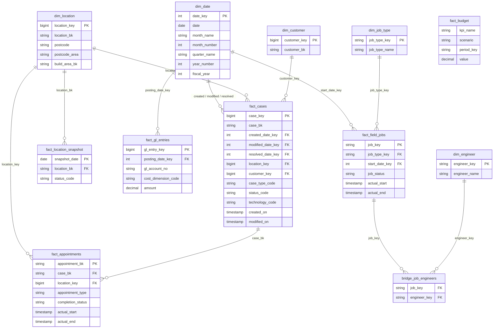

# Data Model and Layer Design

How data is modelled across the Bronze, Silver, Gold and Reporting layers.
All object names are generic. The column lists in the diagram are an illustrative subset (keys and a few measures) chosen to show the modelling approach.

---

## 1. Naming convention

```
<catalog>.<schema>.<object>

<catalog>   environment catalog (Unity Catalog)
<schema>    bronze | silver | gold | reporting
<object>    dim_*  fact_*  bridge_*  v_*  (views)  *_lookup  (reference tables)
```

| Prefix | Meaning | Example |
|---|---|---|
| `dim_` | Dimension (descriptive attributes) | `dim_location` |
| `fact_` | Fact (events and measures) | `fact_cases` |
| `bridge_` | Many-to-many resolver | `bridge_job_engineers` |
| `v_` | Reporting view over Gold | `v_installs` |
| `*_lookup` | Small reference table, maintained as data not code | `status_code_lookup` |

Keys follow one rule everywhere:

- `*_bk` is the **business key** from the source system (stable, used for merges and joins back to source).
- `*_key` is a **surrogate key** generated in Gold (used for fact-to-dimension joins).
- `*_date_key` is an integer in `YYYYMMDD` form, joined to `dim_date`.

---

## 2. Gold star schema (illustrative subset)



`fact_budget` is deliberately standalone. Budget and forecast values are stored per KPI, scenario and period, and are joined to actuals inside the KPI refresh notebooks rather than through a dimension.

### Fact table grain

| Fact | Grain | Notes |
|---|---|---|
| `fact_cases` | One row per case | Current state; modified rows are merged in |
| `fact_appointments` | One row per appointment | Linked to its case by business key |
| `fact_location_snapshot` | One row per location per day | Point-in-time status history |
| `fact_gl_entries` | One row per ledger entry | Immutable, append-style |
| `fact_field_jobs` | One row per field job | Engineers resolved through the bridge table |
| `fact_budget` | One row per KPI, scenario, period | Plan and forecast values |

---

## 3. Layer rules

| Layer | Storage | Contents | Rules |
|---|---|---|---|
| **Bronze** | Data lake, partitioned `source/entity/yyyy/mm/dd/` | Raw JSON exactly as received | Never edited; incremental by watermark; replayable |
| **Silver** | Delta, one table per source entity | Typed, cleansed, validated records | One row per business key; DQ rules applied; schema drift logged |
| **Gold** | Delta, star schema | Facts, dimensions, bridges, KPI tables | Surrogate keys; conformed `dim_date`; business definitions live here |
| **Reporting** | Views and KPI tables | What Power BI reads | Read-only; no business logic in the report layer |

---

## 4. Silver write patterns

| Pattern | Use for | Behaviour |
|---|---|---|
| `merge` | Transactional entities that change | Upsert on business key; incoming batch de-duplicated first (latest modified wins) |
| `append` | Immutable events | Insert only |
| `full_reload` | Small reference tables | Replace the table contents |
| `snapshot` | Status that needs history | Write current state and keep dated history |

The pattern for each pipeline is stored in a control table, so changing a pipeline's behaviour is a data change, not a code change.

**Design note.** A reference entity that receives incremental updates (for example engineer or resource records) should use `merge`, not `full_reload`. A full reload over many incremental Bronze files inserts every historical version of each record, which shows up as duplicate rows.

---

## 5. Control tables

| Table | Purpose |
|---|---|
| `ctrl.watermark` (SQL database) | Bronze watermark per source and entity; run status |
| `field_mappings` (Delta) | Source field, target field, type, transformation and DQ rule per pipeline |
| `pipeline_watermarks` (Delta) | Silver and Gold watermark, write pattern, merge key, target table |
| `pipeline_run_log` | Rows in, rows out, DQ pass and fail counts, duration, status |
| `schema_drift_log` | New or changed source columns detected on each run |
| `deletion_log` / `deletion_archive` | Records removed during reconciliation, with a full copy kept |

Adding a pipeline means inserting rows into these tables. The single parameterised Silver notebook reads them at run time.

---

## 6. Key modelling decisions

**1. Business keys in Silver, surrogate keys in Gold.**
Silver stays close to the source and merges on the business key. Gold adds surrogate keys so facts join to dimensions without depending on source identifiers.

**2. Reference data as tables, not code.**
Status codes, technology groups and cost-account mappings live in lookup tables with flags (for example `is_cancelled`, `is_arpu_posted_sales`). Changing a business rule is an update to a lookup row, with no redeploy and no hardcoded identifiers in notebooks.

**3. Daily snapshot for point-in-time questions.**
Location status changes over time, so a daily snapshot fact answers "what was true at month end". Month-end KPIs read the last snapshot of the month, not current state.

**4. Pre-aggregated KPI tables plus live views.**
Headline KPIs are written to KPI tables (month actual, month budget, variance, year-to-date) so that closed months stay stable. Operational views read Gold directly for current-state analysis.

**5. One definition per metric, shared by every consumer.**
A metric such as net sales is defined once in a reporting view. The KPI refresh notebooks and the cost-per-acquisition view both read that view, so they cannot drift apart.

**6. Deletion handling is a controlled job.**
Source deletions are reconciled in a separate monthly job, scoped per entity and with archive-before-delete. It is not part of the daily run, because removing a record changes historical KPIs.

**7. Parameterised engine over per-source notebooks.**
One Silver notebook driven by `field_mappings` replaces a notebook per source. This keeps behaviour consistent and makes new entities cheap to add.

---

## 7. Data quality

- Rules are defined per field in `field_mappings` (not-null, format, positive value, custom expression).
- Results are written to the run log per pipeline run.
- Pipeline failures raise an alert within minutes.
- Monthly reconciliation compares platform KPIs against finance and source-system figures, with a documented tolerance per KPI.
